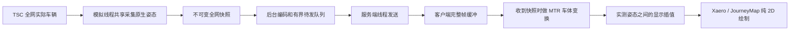

# 全图列车：TSC 原生姿态下发方案

更新：2026-10-21 19:11（Asia/Taipei），Codex。源码基线 main `9e9d980`，MC 1.21.1 / MTR 4.1.0-beta.2 / NeoForge + Fabric。**仅规划，尚未实现；mod 版本保持 1.5.2，既有静态协议保持 v8。**

本文取代此前“全网概要 + 视口路径进度 + 客户端沿轨求车厢”的方案。历史讨论见 Git；其他早期文档如有冲突，以本文和用户最新要求为准。下一站距离和 ETA 均暂停，不随本次位置同步恢复。

## 1. 确定的责任边界

用户要求：缩到整个路网也能看到所有实际列车持续移动；放大任意远处可以显示每节车厢，不依赖玩家附近范围或区块加载。当前地图查看维度是订阅范围，不要求同时绘制不同维度。

**TSC 是唯一运行状态来源。** TSC 已负责发车、路径、加减速、信号、停车、折返和车厢沿轨定位。Overlay 服务端只读这些结果并传输；“TSC 下发”在本项目中指 Overlay 桥接 TSC 状态，不代表 TSC 已自带我们所需的全图地图协议。

| 层 | 本次职责 | 不承担的工作 |
| --- | --- | --- |
| TSC 服务端 | 原有全网模拟；原生车辆/转向架姿态查询 | 不因地图观看人数重复模拟 |
| Overlay 服务端 | 全网枚举、共享定频采集、元数据缓存、编码、发送及活性状态 | 不新建车辆模拟，不求地图最短路来定位车辆，不强制加载区块 |
| Overlay 客户端 | 缓存实测快照、MTR 车体图形变换、显示插值、2D 绘制和悬停 | 不创建 Vehicle/Simulator，不推进 railProgress，不处理行车/信号/调度，不沿轨解算位置 |

客户端允许的数学运算仅用于显示：将服务器提供的 bogie 姿态转换成刚性车体、两帧间插值、投影和屏幕缩放。图形变换不改变权威状态；包停止后车辆不得自行继续运行。

全图流必须覆盖该维度所有实际存在的 TRAIN 实例，包括停车、待发、手动与回库车辆。展示过滤将来可独立提供，但不能用 getIsOnRoute 简单丢弃实例，也不能静默只取最近或前 N 列。未生成的未来班次不属于实际车辆。

## 2. 源码依据与实际缺口

本轮直接读取公共源代码，不再做反编译：

- MTR：[`f05d99efab6f27b3868913438fce2da381e5798f`](https://github.com/Minecraft-Transit-Railway/Minecraft-Transit-Railway/tree/f05d99efab6f27b3868913438fce2da381e5798f)，stonecutter，源码 mod.version 为 4.1.0-beta.2。
- TSC：[`032baafbf9e3b246d1f9cc2d6b4972f1b31254ea`](https://github.com/Minecraft-Transit-Railway/Transport-Simulation-Core/tree/032baafbf9e3b246d1f9cc2d6b4972f1b31254ea)。MTR 源码声明 Core 动态依赖 `+`，不能宣称此提交就是发布 JAR 的精确内嵌版本；落地须用目标依赖编译及运行验证。
- Create：[`7ff2760e4924d35d4bc2e22c4b19923f0178cd16`](https://github.com/Creators-of-Create/Create/tree/7ff2760e4924d35d4bc2e22c4b19923f0178cd16)，借鉴地图订阅、全局车辆来源、共享采样和前后快照，不复制其车型/状态语义。

| 已核对接口/实现 | 本次用法与限制 |
| --- | --- |
| Simulator.tick → sidings.simulateVehicles | 全部 Siding 的车辆由服务端推进，模拟循环不按玩家附近筛选 |
| Siding.iterateVehicles | 公开遍历实际车辆实例；全局来源为 Simulator.sidings，不是 MinecraftClientData.vehicles |
| Vehicle.getVehicleCarsAndPositions | 提供 VehicleCar 和每节一/两个 BogiePosition；每个 bogie 含两个 XYZ + tilt 采样点；调用会计算、分配对象，并非已有全网坐标缓存 |
| Vehicle.getHeadPositionAndTiltAngle | 提供实测参考点，可为缺失编组定义时的显示后备；正常车厢完整时不额外重复查询 |
| Vehicle.getReversed / VehicleExtraData this-route getters | 读取真实方向、当前线路、目的地；不按颜色或最近线路猜所属线路 |
| Simulator.run | 采集排队到模拟线程，输出独立 DTO；入队时间不能冒充实际采样时间 |
| Client.update / Vehicle.writeVehiclePositions | 原有游戏客户端数据受位置和半径限制；不能靠现有 nearby 集合得到全图 |
| MTR PositionAndRotation | 复用 bogie→body 的偏置、yaw/pitch/roll 和角点转换；构造器还查询客户端光照，禁止服务端调用或后台调用 |
| 当前 Overlay | 静态协议 v8 无动态列车；ClientTrainCollector 为 nearby 来源；双地图可共用现有 MapCar、PlanarMapScene、PlanarMapCache |

原生 getBogiePositions 在路径查询为空时可能产生以进度构造的占位 Vector。不能以“坐标 finite”作为真实定位证明。G0 必须验证所涉路径/轨道有效性；无法确认时发送 UNLOCATABLE，保留身份与覆盖计数，不把占位数据画成远处真实列车。验证只检查 Core 的定位前提，不重做路径求解。

## 3. 数据流与首次交互

1. 开地图且启用车辆层时，客户端探测独立动态协议，订阅“地图正在查看维度”的全网车辆。请求不带用于裁剪覆盖的视口或玩家位置。
2. 服务端校验能力、维度与租约，回复 session、subscription generation、实际更新频率、范围为 WHOLE_DIMENSION。首次尽快采集，不等待静态地图下载或下一站信息。
3. 发送编组/服务定义以及首个完整车辆帧。每个帧都包含全维度成员集合，车厢姿态同时对应同次 Core 采样；先原子安装完整基线，再进入连续显示。
4. 正常以 **4Hz、即约 250ms** 为初始采样目标，全网所有列车及所有车厢同等参与。频率为待测参数，不是已达成指标。
5. 相同维度的多个观看者共享一次采集和可复用的编码内容；不会为每个玩家重新调用一轮 Core 姿态查询。传输字节仍随观看人数增长。
6. 缩放和拖图只改变客户端绘制细节，不发起远处车辆“补订阅”。缩远可以用现有整列符号，放大恢复全部车厢；缓存中的全网姿态一直更新。
7. 两个地图共用一个动态控制器和缓存；关闭最后一个地图或关闭车辆层后取消订阅。约 1 秒续租、5 秒租约为起点，无订阅者不再采集/编码动态车辆。

没有动态服务端能力时，客户端明确显示“附近数据”。已建立全网流后即使断更，也先显示过期状态，不偷偷用 nearby 数据填充或叠画另一套车辆。

## 4. 传什么：原生姿态与低频定义

### 稳定身份与帧头

- serverSession：服务器生命周期随机 ID；dimensionEpoch：Simulator 实例/时间轴重建时变化。
- subscriptionId/generation：切维度、取消后重新订阅均拒绝旧代消息。
- trainKey：session + dimension + sidingId + vehicleId；可映射成流内 trainHandle，删除后不复用。
- carIndex：Core 编组中的稳定顺序；reversed 只改变 leading，不把车厢数组反过来改身份。
- frameSequence、Core sampleTime、服务端单调采样时间：分别用于顺序、源数据时间和传输/断更判断。Core 卡住时 heartbeat 不能更新采样时间。

### 低频定义：首次、缺失或内容变化时发送

| 定义 | 内容 |
| --- | --- |
| ConsistDefinition | 有序车型 ID、长度/宽度、bogie 数量和偏移，供 MTR 车体变换；优先使用可序列化的 VehicleCar 白名单，不需要完整行驶路径 |
| ServiceDefinition | Core 当前线路 ID/名称/编号/颜色/类型、目的地；车型显示名可用客户端 MTR 资源，缺资源不阻止位置显示 |

定义有 handle/revision，车辆帧引用明确修订；服务变化不重传几何。按实际所需字段比较，不每轮序列化 VehicleExtraData、整条路径或算全地图哈希。定义缓存只保留实际引用与有界宽限期，变更和车辆撤销后可回收。

### 高频车辆记录

每列包含 trainHandle、consist/service revision、reversed、定位状态、运动连续性标志及有序车厢数据。每节保留原生一/两个 bogie；每个 bogie 两个 PositionAndTiltAngle，均含真实 XYZ 与 tilt。

完整有效姿态无需额外发整列四角或再算车头；首节/末节姿态可用于概览符号。缺定义但参考点有效时可显示明确的临时列车标记；未知定义只缓冲有限帧，不按错误尺寸生成车厢。

本次**不发送用于客户端推进的 railProgress、speed、PathDefinition 或 RailMath 定义**。不新增 VehicleProgressAccessor，不在客户端实例化 TSC Vehicle。现有静态轨道几何仅作背景，与动态定位独立。

## 5. 客户端显示：插值而不模拟

客户端动态状态为 DISABLED → PROBING → WAITING_BASELINE → LIVE；另有 UNSUPPORTED、STALE 和 ERROR。车辆显示缓存不是模拟集合，不写入 MinecraftClientData.vehicles。

- 每个完整收到的原生快照在客户端主线程复用 MTR PositionAndRotation，生成车体中心、姿态和原生角点。只在新快照需要时做，不能每帧为全网反复创建 bogie/body 对象。
- PositionAndRotation 查询光照，但地图不使用 light。G0 单独测这一成本，确保原生调用只在主线程且不会触发远处区块加载；若不满足，再隔离与上游公式一致的纯车体图形变换。此适配只处理现成 bogie 姿态，不复制 Core 路径或运动算法。不得以全图光照查询作为长期隐含开销。
- 使用有限的约 300–500ms 起始显示缓冲，在同车、同编组修订、同 motionEpoch 的相邻实测车体快照之间插值。用本地单调接收时间估计服务器展示时间，不假定两台机器墙上时钟同步；参数按实际抖动调整。
- 对中心做位置插值，对姿态使用最短角差/一致旋转插值，再生成刚性角点。不得直接独立 lerp 四个角点导致车厢缩短或变形。
- 逐帧仅处理实际可见车辆/符号；全网姿态缓存持续更新。每帧先做全列保守包围盒筛选，包含前后快照包围范围、整列所有车厢和符号显示边距，不能只看车头。
- 没有后一个实测快照就停在最新姿态，禁止速度外推或自主跑轨道。首次只有一帧时直接显示该帧。
- Core 明示折返/reversed 改变、编组改变、Simulator 时间重置或明确运动断点时，清该对象插值历史；异常大位移也作为展示断点。未收到 Core 断点时不能保证识别所有短距离瞬移，G0 必须验证可观测边界。
- 约 3 秒没有新采样标记过期；保留最后实测点并显示数据年龄，不把冻结车辆伪装成实时。超过配置期限可隐藏为过期数据，但不得伪报 Core 已撤销。

**误差边界：**离散 XYZ 姿态插值会在急弯处偏离轨道。禁止用客户端沿轨求解器补救。先对高速/最小半径场景测屏幕误差；必要时提高服务端全网采样频率，或由服务端按预算发送更多 TSC 实测样本。不能声称 4Hz 已满足所有速度/缩放。采样时刻姿态误差、插值误差和显示延迟分别报告。

输出继续进入 MapCar → PlanarMapScene，保持纯 2D 的轨道底衬→线路→车辆顺序，保留 XYZ 但不做下穿或高度排序。全网帧不使静态地图缓存失效；插值使用可复用动态缓冲，避免每帧为全网生成 List/MapCar/quad 对象。现有 PlanarMapCache 的动态 list identity 机制须配合显式 pose revision/render time 调整，不能拿旧列表身份误判为未变化。

悬停命中可见车厢后关联整列身份；按 Create 参考显示亮色车型/已证实的名称、淡蓝线路和终点，显示真实可用状态。移除默认的 raw model ID、XYZ 和 Nearby 调试行；调试字段可留调试入口。没有证据时不承诺存在自定义列车名称，不复制 Create 的 Fuel boosted。下一站距离/ETA 本轮不接入。

## 6. 协议、线程与队列

独立动态 `train_*_v1`，能力探测与静态 v8 解耦；不通过 mod 版本 1.5.2 推断是否支持。NeoForge/Fabric 共享 DTO/codec，加载器只实现传输与生命周期适配。

最小消息集合为 Hello/Capabilities、Subscribe/Accepted、KeepAlive/Unsubscribe、DefinitionPart、FramePart、Resync/StreamStatus。逻辑消息可合并 envelope；本次没有视口 membership 流、路径定义流或下一站查询。

1. Minecraft 服务端线程维护租约，每个 Simulator 最多一个 queued/in-flight 采集。采集请求合并，Core 忙时跳过旧调度，不堆积追赶任务。
2. Simulator 线程枚举、读 Core 原生姿态和必要定义，复制到自有 primitive DTO/数组；采样实际执行时记时间。禁止跨线程传递 Vehicle、VehicleExtraData、Rail、PathData 等活动引用。
3. 有界后台任务编码只读数据；同维度可共享正文。最终回服务端线程复核订阅代与连接再发。每订阅待发只保留最新完整逻辑帧；正在发送的一帧须发完，后续再取最新帧，不能各片分别 latest-only。
4. 客户端有界解码/重组，主线程原子安装完整帧。单帧最多 16MiB 解压后数据、单定义 8MiB、同时最多两个在途姿态帧作为初始边界；限制总预算和超时，不能把个别上限简单相乘后无限接收。
5. 每片初始应用正文上限 192KiB，编码前确认两个加载器的实际 payload 限制；帧携带 session/dimension/epoch/generation/sequence/partCount/totalLength/完整性信息。大小限制先检查，再分配大数组。

第一版每轮为**完整全维度集合**，以此简化成员、缺失和恢复语义。只能丢掉尚未提交传输的整个旧帧，不能把完整帧中的前 N 列当作最新全图。定义先送、未知修订有界等待；必要定义与基线有优先级，避免位置流永远挤占冷启动。

车辆确实不在成功枚举的完整集合中才撤销。单车定位失败必须作为 UNLOCATABLE 记录保留，枚举整体失败发错误状态，不发空集合。完整帧没收齐不删车；停车即使姿态不变也在全局成员集合中。后续若优化成增量，必须另行定义基线/确认和丢弃语义，不能将当前完整帧 latest-only 直接套到依赖前帧的差分流。

配每连接发送字节/排队时长预算。预算不足先合并旧帧、压缩、整体降频并明确实际频率/数据年龄；不能改成附近或视口子集。连完整范围也承载不了时明确 stream error/unsupported capacity，保留最后完整帧为过期状态，不宣称“全图实时”。已交给 TCP/Netty 的字节不能撤回。

断开、服务器停止、Simulator 更换、切维度、地图关闭均清对应任务/订阅/重组/显示历史。使用生命周期事件提供的 server，不依赖未赋值的静态 serverInstance。专用服务器不得加载 org.mtr.render 或其他客户端类。

## 7. 成本与允许的优化

设 S 为 Siding 数、N 为实际列车数、C 为车厢总数、L 为单车实际路径段数、V 为可见车厢数、f 为采样频率、U 为观看同一维度人数。

- 共享采集约 O(S + C log L)，因为每个 bogie 定位查询原生路径索引；对象分配约 O(C)。每秒乘 f，但不因 U 重跑一遍采集。
- 原始编码/客户端接收转换为 O(C) 每帧；完整帧带宽 O(U × C × f)。客户端有界快照缓存 O(C)，编组/服务定义另计。
- 简单客户端视野筛选 O(N)，插值/动态符号构建 O(V)。全网缩小时 V 可以等于 C；不能把“可见”当成天然很小。
- 绘制退到每列概览符号时仍显示所有 N 列的运动，不减少同步覆盖。相同定义共享、静态缓存、缓冲复用优先于写自己的运动算法。

双 bogie 车厢包含 4 个 XYZ+tilt，直接 double 为 **128B/节/样本**，单 bogie 为 64B。以下假设全部双 bogie、每列 8 节、4Hz，仅原生数值、不含包头/身份/定义/压缩，十进制单位：

| 列车数 | 原始 double/客户端 | 局部 float 方案数值项参考值 |
| --- | ---: | ---: |
| 100 | 0.410MB/s | 0.205MB/s + 每列 double 原点等 |
| 1000 | 4.096MB/s | 2.048MB/s + 每列 double 原点等 |
| 5000 | 20.480MB/s | 10.240MB/s + 每列 double 原点等 |

1000 列、10 人观看时仅原始数值就约 40.96MB/s 总出站，不能称全网原生姿态几乎零成本。旧进度流估算不适用于本方案，Create 每节两个 float XYZ 的 24B 也不等价于 MTR 原生完整 bogie 数据。

先用 double 做正确性基线；随后在不改变数据语义的前提下，验证“每列 double 原点 + bogie 局部相对 float XYZ/tilt”的编码。减原点后再转 float，避免三千万世界坐标的绝对 float 精度损失；长编组和最远坐标必须测。压缩收益、车型复用和停车去重均按实际编码字节测，不预先承诺压缩比。

可优化：局部坐标编码、共享编组/服务定义、有界压缩、缓冲复用、相同全网帧共享编码、全维度统一降频、基线明确后再做停车绝对更新去重。不可用的“优化”：只同步玩家附近/视口车辆、隐藏前 N 以外列车、客户端重跑 Core 或自行预测运动。

## 8. 实施阶段与验收

| 阶段 | 落地内容 | 必须通过 |
| --- | --- | --- |
| G0 原生导出与变换对照 | CoreTrainAdapter；真实全网枚举、bogie DTO 和 MTR 车体快照原型；不建路径/进度求解器 | 目标 MTR 依赖可编译；专用服务器无客户端类；远离玩家/未加载区块可定位；单/双/偏置 bogie、曲线、坡度/侧倾、反向的采样时刻角点对照；无效路径占位不误画 |
| G1 全网完整流 | 独立能力、维度订阅、共享 4Hz 采集、定义、完整帧原子重组和双端生命周期 | 全图列车与车厢计数对 Core 100% 一致；两个远离玩家且互相远离的区域同时持续更新；无订阅动态采集/发送为零 |
| G2 显示与成本 | 实测快照插值、双地图 provider、静态缓存隔离、来源切换、Create 参考悬停；精度验证后的编码优化 | 全网缩小所有列车运动；拖到任意远处不等待重新订阅；放大每节车厢对位；断更不外推；曲线插值误差/延迟和 CPU/带宽实测 |
| G3 异常及平台验收 | 定义修订、删除、过期、重启/切维度、发送背压、边界检查、大车队性能 | 停车不消失、半帧不误删、撤销不残留、错代不复活、无后台无限积压；NeoForge/Fabric 构建及专服/客户端验证有各自记录 |

G0/G1 是中间结果，完成 G2+G3 才能宣称全图车辆功能完成。本轮只调整计划；下一站距离与 ETA 无实施阶段，不复原已搁置草稿。

建议边界（后续实现时可按工程规模合并类）：

- train/core/CoreTrainAdapter：唯一接触 Core 活动对象的导出层，仅模拟线程。
- train/server/TrainSubscriptionManager、TrainSnapshotCollector、TrainDefinitionRegistry：租约、共享采样、轻量定义。
- train/network/TrainProtocol、TrainFrameCodec：共享纯数据/校验，加载器适配独立。
- train/client/ClientTrainStream、TrainPoseBuffer、MtrBodyTransform、TrainDataProvider：原子安装、MTR 图形变换、显示插值及来源选择；没有 TrainSimulator/PathResolver。
- 双地图 renderer 读取 provider，沿用 PlanarMapScene/MapCar 样式，调整动态缓存与缓冲复用；网络工作从客户端 tick 驱动，不在 render 回调直接发送。

验证分开记录覆盖正确性、采样真值误差、插值误差、显示延迟和性能，不以构建通过代替游戏验证。性能矩阵至少包含 100/1000 列（5000 为压力探测）、1/8/16 节、1/10 个观看者、全网缩小/局部放大、密集共线/高速急弯、停车/折返/撤销/编辑、多维度、100–300ms RTT 与抖动、Core 卡顿和反复开关地图。

记录采集/转换/编码 P50/P95/P99、分配率/GC、实际 payload 与总出站、队列年龄/长度、客户端动态帧时间及原生光照成本。先在约定硬件测基线再确定规模/频率预算，不沿用旧进度流的 ≤2ms 目标作为已验证能力。若 4Hz 曲线显示或大网成本不合格，先报告具体限制并在服务端姿态流内调整，不私自恢复客户端模拟。

本轮仅修改设计与协作状态文档，未实现功能、未生成新测试包、未运行游戏或性能测试。现有代码仍只显示附近车辆；版本继续 **1.5.2**。
