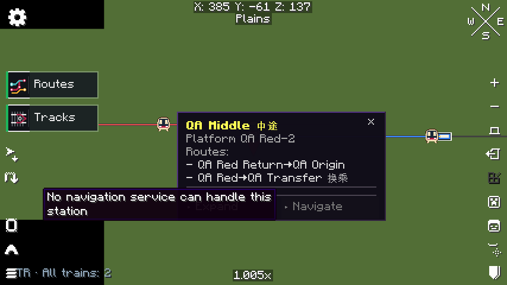
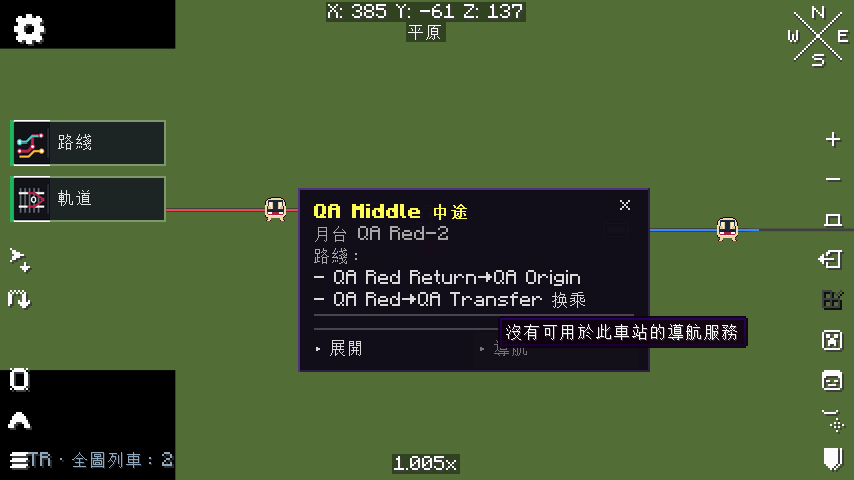
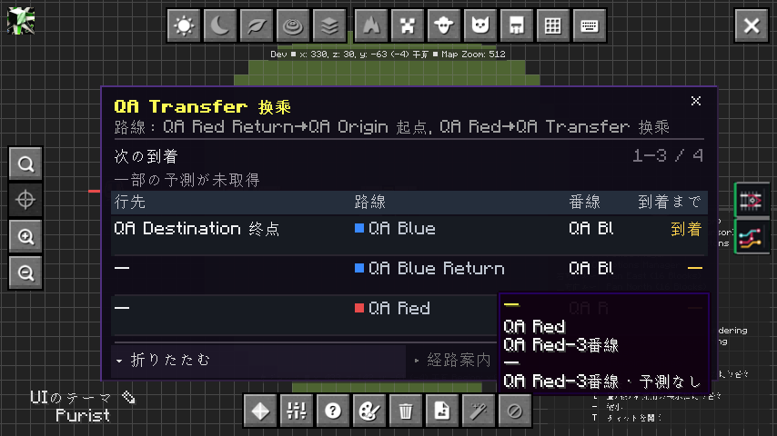
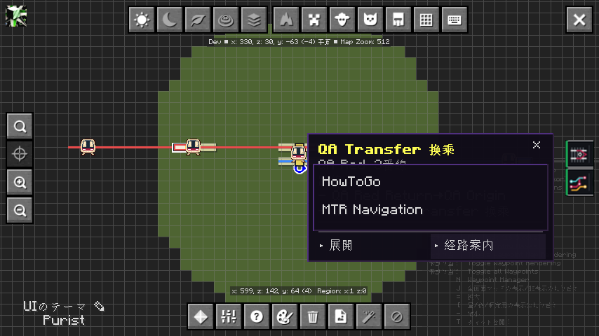

# HowToGo, Navigate availability, and localization

Verified on 2026-11-11, Asia/Taipei (UTC+08:00). Development branch: `feat/howtogo-navigation-i18n`. Overlay remains **1.5.3**; published release attachments were not replaced.

## Behavior

- Navigate considers the selected station, current catalog epoch and provider availability. With no callable provider, it is dimmed and does not react to clicks. Availability is checked again when clicked, so an obsolete menu cannot invoke an unavailable or closed provider.
- The new optional registration overload accepts an availability predicate. Existing three-argument consumers keep their ABI. Provider exceptions are isolated; diagnostics are emitted once per owner rather than on every frame.
- An optional HowToGo adapter calls its public `Destination(String,int,int,int,String)` constructor and `Navigation.setTarget(Destination)` method. No HowToGo implementation is bundled, and no private routing state is accessed. Station coordinates must be finite, fit integer block coordinates, and belong to the player's current dimension. Negative fractional coordinates are floored to blocks.
- An explicit HowToGo selection passes the actual catalog station name and position, uses HowToGo's configured mode, then closes the map for its native HUD. Multiple available providers show a chooser. Hovering or opening a station panel never starts navigation.
- English is the resource fallback. English, Simplified Chinese, Traditional Chinese and Japanese each have **100 matching keys**. Controls, PIDS, tooltips, commands and diagnostic marker text follow the selected game language. User-owned station and route names are preserved.

The old Xaero button textures contain English text. Controls now sample only their neutral icon region and draw translated labels. Command success is represented by a boolean and a separate translated message, replacing English-string parsing. A missing/unready JourneyMap API or a failed marker display now returns failure correctly.

## Actual artifacts and environment

- Minecraft 1.21.1; Java 21.0.11; NeoForge 21.1.249; MTR 4.1.0-beta.2.
- Xaero World Map 1.45.0, Minimap 26.4.2, JourneyMap 6.0.8.
- Published [HowToGo NeoForge 0.2.1, file 9082013](https://www.curseforge.com/minecraft/mc-mods/how-to-go/files/9082013): SHA256 `00017454e639b22a80f9adc167527b55f29cf9bf96face894db135c751ac7d14`.
- Public source inspected at [Dong-awa/howtogo, 5ac3041](https://github.com/Dong-awa/howtogo/tree/5ac3041240007884ded49abbde37949ab7f6d8bd). This newer source inspection is not a runtime compatibility claim for every release.
- The second client run also loads the real MTR Navigation fork JAR, whose provider uses the existing three-argument API. Its exact artifact hash is recorded in [evidence](howtogo-navigation-i18n-evidence.json).
- A separate copy of the earlier four-station/two-train MTR fixture is saved as `run/saves/HowToGoQa-20261111`. The source world was not edited.

## Results

**16 native UI cases passed:** two map hosts × four languages × two provider configurations.

| Configuration | Checked on both maps in all four languages |
| --- | --- |
| Neither navigation mod installed | No providers; Navigate disabled; clicks keep the station panel open; translated unavailable tooltip; expanded arrival board; map does not pause the integrated server |
| HowToGo and MTR Navigation installed | Two real providers in the chooser; HowToGo selection closes the map; native HowToGo target matches the selected station's name, source and exact block coordinates; alternating target stations prevents a stale target from passing |

Every captured language label was compared against its actual locale resource, and unknown-station availability was zero. Screenshots are original Minecraft framebuffer PNGs; raw stage-state SHA256 values and production artifact hashes are recorded in the evidence file.

No provider, English:



Traditional Chinese and Japanese:




Two real providers, Japanese:



## Build and contract checks

- NeoForge and Fabric 1.21.1 production builds passed.
- Java unit suite: **108 tests, 107 passed, 1 skipped, 0 failures/errors**. The skipped test is the opt-in world generator. The actual HowToGo artifact signature check ran, rather than being skipped.
- Added registry regression cases for readiness changes between render/click, closed/replaced registrations, multiple providers and optional-class failures.
- `python tools/validate_languages.py` verifies duplicate keys, key parity, formatting placeholders, unexpected blank translations and static Java translation references.
- API classes remain Java 17 (class version 61). Production JARs contain neither the development QA bridge nor HowToGo/MTR implementation classes; all four language resources are present in both loader artifacts.
- Native input runs through Minecraft's `MouseHandler` and real NeoForge screen events. Direct `Screen.mouseClicked` was rejected as a test-control approach because it bypasses those hooks. The driver also zooms out when a station is physically covered by the map toolbar.

## Scope and limits

This verifies the **destination handoff**, not completion of a HowToGo journey. The copied MTR fixture contains no HowToGo road graph; HowToGo therefore displays its native **No route** feedback. Overlay does not invent road links, override travel preferences, or suppress that result. HowToGo's own HUD translations are owned by that mod.

The actual client matrix is NeoForge singleplayer. Fabric passed build/packaging checks; no Fabric client handoff is claimed. Older Minecraft compatibility targets, production launchers, multiplayer, large-network performance, road routing/guidance and every possible window/font size were not tested here. No mod version, release tag, published attachment or older compatibility repository was changed.

## Reproduce

Use JDK 21 and the matching MTR/maps in `run/mods`. The fixture must be a separate test save. The loopback CLI and its read-only inspection code exist only with the explicit Gradle property:

```powershell
.\gradlew.bat runClient -PnavigationQa -Pquickplay=HowToGoQa-20261111
python tools/navigation_integration_qa.py absent
python tools/overlay_qa_cli.py quit
```

With the client stopped, run `python tools/download_howtogo_test.py`, copy the pinned JAR into `run/mods`, and install the real MTR Navigation fork JAR to exercise multiple providers. Relaunch, then:

```powershell
python tools/navigation_integration_qa.py providers
python tools/overlay_qa_cli.py quit
```

The HTTP bridge binds loopback port 18762. Raw state, original PNGs and JSONL are under `build/navigation-qa/`; passing results are `absent-result.json` and `providers-result.json`. Both completed clients exited normally and saved all dimensions. The evidence bundle includes the passing logs; earlier test-driver diagnostic attempts remain local and are not represented as passes.
